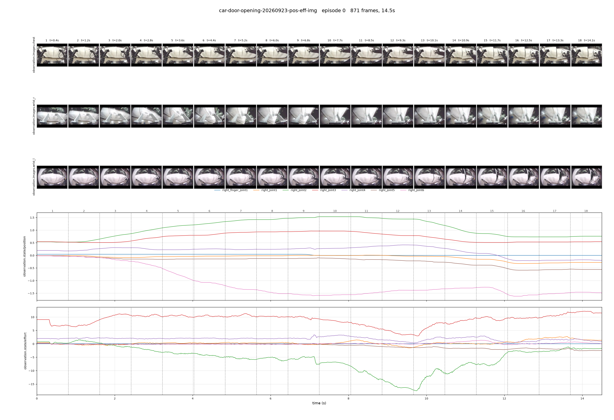
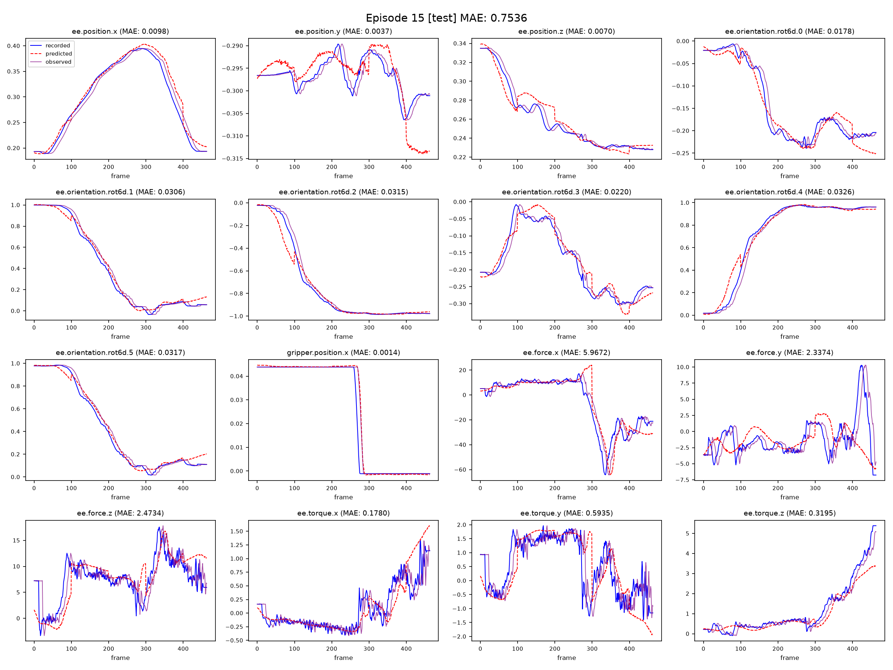
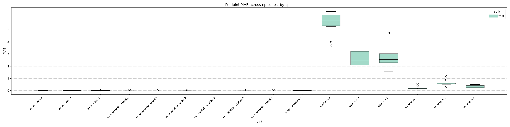
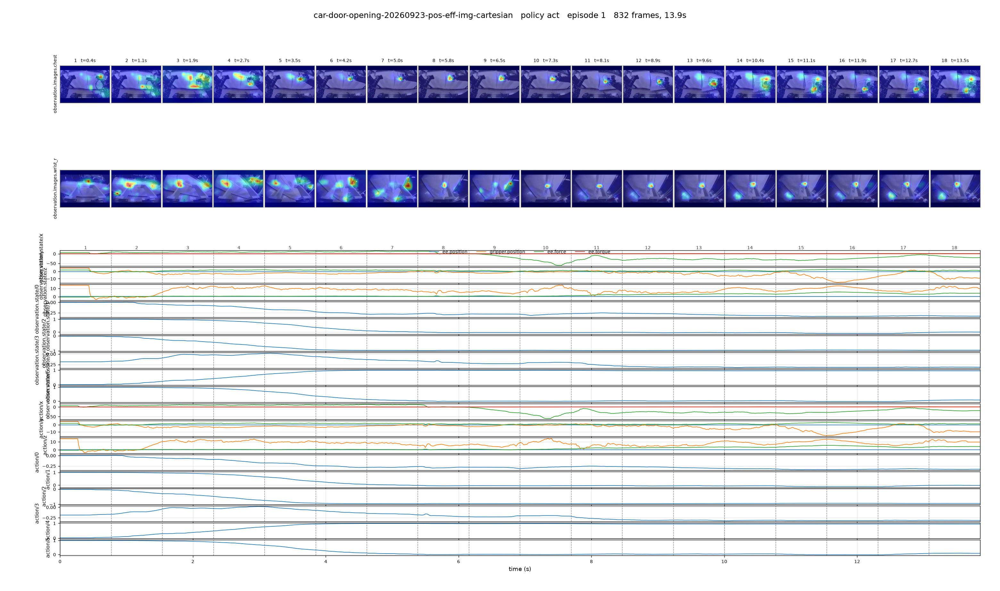

# Data Conversion

## Validate MCAP

## Convert MCAP to LeRobotDataset v3.0

## Edit LeRobotDataset

# Data Visualization

## Dataset plots

`lerobot-dataset-plot` saves one static overview image per episode: a strip of camera keyframes sampled evenly across the episode, above time-synced plots of the state and action signals. Requires the `dataset_viz` extra.

Flags:

- `--dataset-path`: local dataset folder containing `meta/info.json` (required).
- `--episodes`: episode indices to plot (default: all).
- `--feature-keys`: 1-D feature keys to plot (default: `observation.state action`).
- `--obs-plot-groups`: dimension groups to plot, one subplot each (default: `position velocity effort`). If none match the dataset, every group is plotted.
- `--image-observations`: RGB video camera keys for the keyframe strips (default: all RGB cameras).
- `--num-image-samples`: keyframes per camera per episode (default: 18, minimum 1).
- `--output-dir`: where to write `episode_<i>.png` (default: `<dataset-path>/episode_plots/`).
- `--dpi`: saved figure resolution (default: 130).
- `--tolerance-s`: timestamp tolerance for dataset loading and video decoding (default: 1e-4).

Example:

```bash
lerobot-dataset-plot \
  --dataset-path /path/to/<dataset_name>
```

<p align="center">
  
</p>

# Model Training

## Train locally

List every flag. The `--policy.*` flags are only listed once a policy type is given:

```bash
lerobot-train --help
lerobot-train --policy.type=act --help
```

Example:

```bash
lerobot-train \
  --dataset.root=/path/to/<dataset_name> \
  --policy.type=act \
  --job_name=act-<dataset_name> \
  --dataset.image_transforms.enable=true \
  --dataset.image_transforms.max_num_transforms=3 \
  --dataset.exclude_features='["observation.images.wrist_l"]' \
  --policy.chunk_size=100 \
  --policy.n_action_steps=100 \
  --policy.normalization_mapping='{"ACTION":"MEAN_STD","STATE":"MEAN_STD","VISUAL":"IDENTITY"}' \
  --policy.kl_weight=10.0 \
  --policy.n_encoder_layers=4 \
  --policy.n_decoder_layers=7 \
  --policy.freeze_vision_backbone=false \
  --backbone=resnet18 \
  --batch_size=8 \
  --steps=100000 \
  --save_freq=10000 \
  --log_freq=200 \
  --dataset.split_ratio='[0.9,0.0,0.1]' \
  --accelerator.mixed_precision=bf16 \
  --wandb.enable=false
```

- `--dataset.root`: local dataset directory (LeRobotDataset v3.0).
- `--dataset.exclude_features`: observation keys to drop for this run, e.g. a camera.
- `--dataset.split_ratio`: train/val/test episode weights; two values disable the test split.
- `--policy.chunk_size` / `--policy.n_action_steps`: actions predicted per inference and actions executed before re-inferring.
- `--backbone`: vision backbone alias (`resnet18/34/50` or a DINO alias).
- `--save_freq`: checkpoint every N steps, plus one after the last step.

## Train kinetic_act (depth, object distance and stage heads)

`kinetic_act` is ACT plus a depth camera input and three optional supervised heads: the distance of the object of interest from the RealSense camera and the task stage for each future step of the action chunk, and an object mask on the RealSense RGB tokens. Every head is off until its label key is set, so a bare `--policy.type=kinetic_act` run is equivalent to ACT.

The labels are added to a copy of the dataset with `lerobot-label-object-task`. SAM 3 segments the object in the RealSense RGB image, the median aligned depth under the mask gives the distance in meters, and thresholds on the gripper command, the distance and the joint displacement give the stage. The depth feature must be aligned to the RGB image. Requires the `transformers-dep` extra.

Flags:

- `--repo_id` / `--root`: source dataset. `--new_repo_id` / `--new_root`: where the labelled copy is written.
- `--rgb_image_key` / `--depth_image_key`: RealSense RGB and depth features (default: `observation.images.realsense`, `observation.images.realsense_depth`).
- `--object_text_prompt`: SAM 3 text prompt (default: `door handle`). `--sam3_model_name_or_path`: hub id or local weights (default: `facebook/sam3`).
- `--gripper_action_channel_name`: gripper channel of `action` (default: `gripper.position.x`).
- `--labels_to_write`: labels to add, any of `object_distance`, `stage` and `object_mask` (default: all three). The mask needs only the RGB feature. The distance needs the aligned depth. The stage is computed from the distance, so it needs the depth as well.
- `--gripper_closed_threshold`, `--grasp_distance_meters`, `--pull_joint_displacement_threshold` (required with the `stage` label): grasp starts when the gripper command is below the first and the object distance below the second. Pull starts when the joint positions have moved more than the third from where the grasp started. Stages never go backwards within an episode.
- `--mark_missing_labels`: when SAM 3 finds no object in a frame, write a missing marker instead of filling the gap (default: true). A missing distance is NaN and a missing mask is filled with 255. With `false`, the distance is carried forward from the last valid frame and the mask is empty. The stage is never missing, because it does not depend on the detection of a single frame.
- `--mask_score_threshold`, `--mask_downsample_factor`, `--distance_median_filter_frames`: SAM 3 score cutoff (default: 0.4), mask label resolution as image size divided by the factor (default: 16), and an odd median filter window over the distance (default: 5).
- Progress: a frame progress bar shows the speed and the episode in progress, with one log line per episode giving its frame count and the frames where SAM 3 found no object.
- `--debug_output_directory`, `--debug_frames_per_episode`: write mask overlays and a distance and stage plot per episode, to check the labels before training. The plots need the `matplotlib-dep` extra and are written when a distance or stage label is computed.

Example:

```bash
lerobot-label-object-task \
  --repo_id local/<dataset_name> \
  --root /path/to/<dataset_name> \
  --new_repo_id local/<dataset_name>_labelled \
  --new_root /path/to/<dataset_name>_labelled \
  --gripper_closed_threshold 0.02 \
  --grasp_distance_meters 0.5 \
  --pull_joint_displacement_threshold 0.05 \
  --debug_output_directory /path/to/label_debug
```

Then train on the labelled copy. Single GPU, inside the training container:

```bash
lerobot-train \
  --dataset.root=/data/datasets/<dataset_name> \
  --policy.type=kinetic_act \
  --job_name=kinetic_act-<dataset_name> \
  --dataset.image_transforms.enable=true \
  --dataset.image_transforms.max_num_transforms=3 \
  --dataset.exclude_features='["<feature_key>"]' \
  --dataset.exclude_episodes='[<episode_indices>]' \
  --policy.chunk_size=50 \
  --policy.n_action_steps=50 \
  --policy.n_encoder_layers=4 \
  --policy.n_decoder_layers=7 \
  --policy.normalization_mapping='{"ACTION":"MEAN_STD","STATE":"MEAN_STD","VISUAL":"IDENTITY"}' \
  --policy.kl_weight=10.0 \
  --policy.object_distance_label_key=observation.object_distance \
  --policy.stage_label_key=observation.stage \
  --policy.stage_class_count=<number_of_stages> \
  --policy.object_mask_label_key_per_camera='{"<rgb_camera_key>":"<object_mask_key>"}' \
  --policy.use_camera_identity_embedding=true \
  --backbone=resnet18 \
  --batch_size=8 \
  --steps=200000 \
  --save_freq=10000 \
  --log_freq=200 \
  --seed=1000 \
  --dataset.split_ratio='[0.9,0.0,0.1]' \
  --accelerator.mixed_precision=bf16 \
  --wandb.enable=false
```

- `--policy.*_label_key`: dataset key of each label. Set only the heads you want. The distance and stage labels are loaded for every step of the chunk, like the actions. A label column whose head is not set stays in the dataset and is listed as an unused model input. Drop it with `--dataset.exclude_features` if you want the inputs clean.
- Missing labels: a distance of NaN, a stage below 0 or a mask with any cell of 255 is left out of its loss, the same way padded steps are, so labels may be missing on random frames. A label that is missing for every frame of a batch adds no loss and no gradient. The dataset needs no other change.
- `--policy.*_loss_weight`: weight of each head's loss next to the action loss (default: 1.0). `--policy.object_mask_positive_class_weight` raises the cost of missing object cells.
- `--policy.normalization_mapping`: `VISUAL` is `MEAN_STD` for a metric depth map. A 3-channel depth image keeps `VISUAL` at `IDENTITY`.
- `--policy.use_camera_identity_embedding`: lets the encoder tell the cameras apart. Recommended with depth.
- A DINO backbone is selected with `--policy.vision_backbone=<hub id>` and `--policy.pretrained_backbone_weights=<hub id>`. The DINO aliases of `--backbone` are only accepted for `act`.

The object distance, stage and mask logits are returned by `predict_action_chunk_with_auxiliary_outputs`. `select_action` returns actions only, so recording, evaluation and the ROS 2 node work unchanged.

## Train on cloud GPU instance

### Lambda

#### Step 1: Set up the instance

Run first, from your laptop, once the instance is up. `scripts/setup_lambda_train.sh` rsyncs the dataset, clones this repo on the GPU instance, builds the training container and verifies CUDA and the dataset. It does not start training.

Flags (`./scripts/setup_lambda_train.sh --help` prints them):

- `--ip`: Lambda public IP (required).
- `--ssh-key`: SSH private key.
- `--user`: SSH user (default: `ubuntu`).
- `--dataset`: local LeRobotDataset directory (required unless `--skip-dataset`).
- `--dataset-name`: remote folder under `datasets/` (required with `--skip-dataset`; defaults to the basename of `--dataset`).
- `--skip-dataset`: the dataset is already on the GPU instance.
- `--skip-build`: start the container without rebuilding the image.

Example:

```bash
./scripts/setup_lambda_train.sh \
  --ip <INSTANCE_IP> \
  --user ubuntu \
  --ssh-key ~/.ssh/<lambda-key>.pem \
  --dataset /path/to/<dataset_name>
```

#### Step 2: Open the training container

Connect to the GPU instance, attach to the `train` tmux session and open a shell in the container:

```bash
ssh -A -i ~/.ssh/<lambda-key>.pem ubuntu@<INSTANCE_IP>
tmux attach -t train
docker exec -it lerobot-train bash
```

#### Step 3: Start training

Run inside the container. The dataset is mounted at `/data/datasets/<dataset_name>`. Flags are explained under [Train locally](#train-locally).

Single GPU:

```bash
lerobot-train \
  --dataset.root=/data/datasets/<dataset_name> \
  --policy.type=act \
  --job_name=act-<dataset_name> \
  --dataset.image_transforms.enable=true \
  --dataset.image_transforms.max_num_transforms=3 \
  --policy.chunk_size=100 \
  --policy.n_action_steps=100 \
  --policy.normalization_mapping='{"ACTION":"MEAN_STD","STATE":"MEAN_STD","VISUAL":"IDENTITY"}' \
  --policy.kl_weight=10.0 \
  --backbone=resnet18 \
  --batch_size=8 \
  --steps=100000 \
  --save_freq=10000 \
  --log_freq=200 \
  --dataset.split_ratio='[0.9,0.0,0.1]' \
  --accelerator.mixed_precision=bf16 \
  --wandb.enable=false
```

Multi-GPU (DDP). Set `--num_processes` to the GPU count.

> [!NOTE]
> `--batch_size` is per GPU, so the effective batch size is `batch_size × num_processes`. LeRobot does not scale the learning rate or `--steps` for you. With 2 GPUs the command below trains on an effective batch of 16, so adjust `--optimizer.lr` (e.g. linear scaling) or `--steps` if you want a run equivalent to single GPU. See [multi_gpu_training.mdx](docs/source/multi_gpu_training.mdx#batch-semantics-learning-rate-and-steps).

```bash
accelerate launch --multi_gpu --num_processes=2 \
  $(which lerobot-train) \
  --dataset.root=/data/datasets/<dataset_name> \
  --policy.type=act \
  --job_name=act-<dataset_name> \
  --dataset.image_transforms.enable=true \
  --dataset.image_transforms.max_num_transforms=3 \
  --policy.chunk_size=100 \
  --policy.n_action_steps=100 \
  --policy.normalization_mapping='{"ACTION":"MEAN_STD","STATE":"MEAN_STD","VISUAL":"IDENTITY"}' \
  --policy.kl_weight=10.0 \
  --backbone=resnet18 \
  --batch_size=8 \
  --steps=100000 \
  --save_freq=10000 \
  --log_freq=200 \
  --dataset.split_ratio='[0.9,0.0,0.1]' \
  --accelerator.mixed_precision=bf16 \
  --wandb.enable=false
```

Runs are saved to `model_zoo/<dataset_name>/<job_name>` on the GPU instance.

# Model Evaluation

## Open-loop evaluation

`lerobot-eval-open-loop` replays recorded dataset episodes through a trained checkpoint frame by frame and compares the predicted actions with the recorded ones. It needs no robot and no simulator. Episodes are drawn from the `split_info.json` that training writes next to the checkpoint, so held-out validation and test episodes are picked for you.

List every flag:

```bash
lerobot-eval-open-loop --help
```

Flags:

- `--policy.path`: checkpoint to evaluate, the `pretrained_model` directory (required). It is read from the command line and not shown in the `--help` flag list.
- `--dataset.root`: local dataset directory to replay (LeRobotDataset v3.0).
- `--dataset.exclude_features`: observation keys to drop, e.g. a camera. Use the same exclusion as in training.
- `--dataset.episodes`: explicit episode indices, e.g. `'[3, 7]'`. Overrides `--split`.
- `--dataset.task_override`: replace the task string of every sample.
- `--split`: `train`, `val`, `test` or `all` (default: `all`). Needs a `split_info.json` next to the checkpoint unless it is `all`.
- `--episodes_per_split`: episodes evaluated per split; zero or less evaluates every episode of the split (default: 3).
- `--seed`: seeds the episode sampling only (default: 42). Reuse it to compare checkpoints on the same episodes.
- `--policy.n_action_steps`: set to `1` to re-infer at every frame instead of once per action chunk.
- `--output_dir`: where results are written (default: `<checkpoint step dir>/eval_open_loop`).
- `--save_plots`: write the per-episode joint plots and the per-joint MAE plot (default: `true`).
- `--dpi`: plot resolution (default: 150).
- `--rename_map`: rename observation keys to match the policy's input keys.

Example, evaluating every held-out test episode:

```bash
lerobot-eval-open-loop \
  --policy.path=model_zoo/<dataset_name>/<job_name>/checkpoints/last/pretrained_model \
  --dataset.root=/path/to/<dataset_name> \
  --dataset.exclude_features='["observation.images.wrist_l"]' \
  --split=test \
  --episodes_per_split=0
```

<p align="center">
  
</p>

<p align="center">
  
</p>

Results are written to `eval_open_loop/` next to the checkpoint:

- `metrics_summary.json`: metrics averaged overall and per split.
- `metrics_per_episode.csv`: one row per episode, with a per-joint MAE column.
- `plots/episode_<index>_<split>.png`: recorded, predicted and observed trajectories per joint.
- `plots/per_joint_mae_by_split.png`: per-joint MAE across episodes, per split.

## Simulation rollout evaluation

## Attention visualization (if policy is transformer-based)

`lerobot-attention-plot` saves one overview image per episode for an ACT checkpoint: camera keyframes with the policy's attention drawn over them as a heatmap, above time-synced plots of the state and action signals. The attention is the decoder cross-attention rolled out through the encoder self-attention, mapped back onto each camera's image patches. It only supports ACT checkpoints. Requires the `dataset_viz` extra.

List every flag:

```bash
lerobot-attention-plot --help
```

Flags:

- `--dataset-path`: local dataset folder containing `meta/info.json` (required).
- `--policy-path`: local ACT checkpoint directory (the `pretrained_model` folder) or Hub id (required).
- `--episodes`: episode indices to plot (default: all).
- `--feature-keys`: 1-D feature keys to plot (default: `observation.state action`).
- `--obs-plot-groups`: dimension groups to plot, one subplot each (default: `position velocity effort`).
- `--image-observations`: policy camera keys to overlay (default: every camera in the checkpoint).
- `--num-image-samples`: keyframes per camera per episode (default: 18, minimum 1).
- `--output-dir`: where to write `episode_<i>.png` (default: `<dataset-path>/attention_plots/`).
- `--dpi`: saved figure resolution (default: 130).
- `--tolerance-s`: timestamp tolerance for dataset loading (default: 1e-4).
- `--device`: torch device (default: the checkpoint's device after auto-selection).
- `--heatmap-alpha`: blend weight of the heatmap over the image (default: 0.5).

Example:

```bash
lerobot-attention-plot \
  --dataset-path /path/to/<dataset_name> \
  --policy-path model_zoo/<dataset_name>/<job_name>/checkpoints/last/pretrained_model
```

<p align="center">
  
</p>

# Model Inference
